

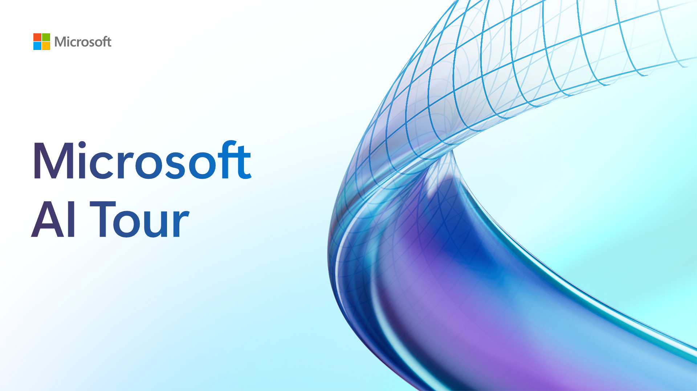

<!-- 
Image description: 
Microsoft AI Tour opening slide: the Microsoft logo top left, "Microsoft AI Tour" in large blue gradient text, and a translucent blue and violet ribbon graphic on the right.

Timing: 0 seconds
Cumulative: 0:00

-->

<!--
Speaker notes:
(None. Holding slide.)

Presenter Guidance:
Holding slide. Leave this up while attendees take their seats. Don't speak to it; begin the session on the next slide.
-->

---

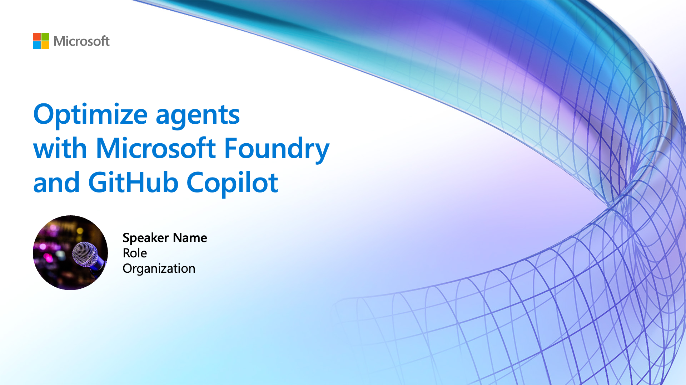

<!-- 
Image description: 
Title slide for "Optimize agents with Microsoft Foundry and GitHub Copilot," with the Microsoft logo, a ribbon graphic, and a speaker block: a circular placeholder photo (a microphone on stage) beside placeholder text for Speaker Name, Role, and Organization.

Timing: 20 seconds
Cumulative: 0:20

-->

<!--
Speaker notes:
Hi everyone, and welcome. I'm [name], [role] at [organization]. Today we want to talk about how you can optimize agents with Microsoft Foundry and GitHub Copilot.

We'll do it by following one team as they take an agent from "it works" to "it's measurably better," one step at a time.

Presenter Guidance:
Before the session, replace the placeholder photo with your own headshot, and update your name, role, and organization. Keep the intro short and personal, then move on to the story.
-->

---

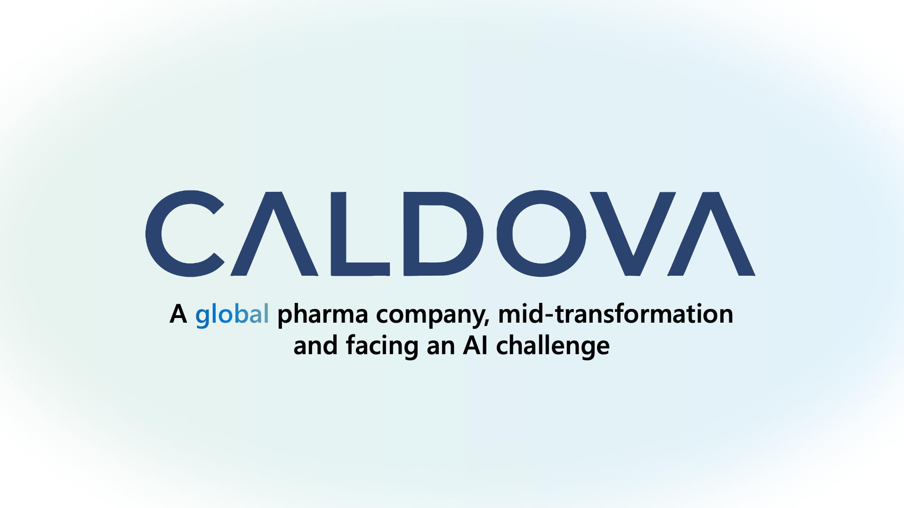

<!-- 
Image description: 
Caldova logo with the tagline "A global pharma company, mid-transformation and facing an AI challenge" on a soft blue and green gradient.

Timing: 20 seconds
Cumulative: 0:40

-->

<!--
Speaker notes:
Meet Caldova, a pharmaceutical company in the middle of an AI transformation. Their first project is to rethink their internal travel portal with AI. So they bring in Contoso to build a travel concierge for their employees.

But they quickly run into a challenge.

Presenter Guidance:
None.
-->

---

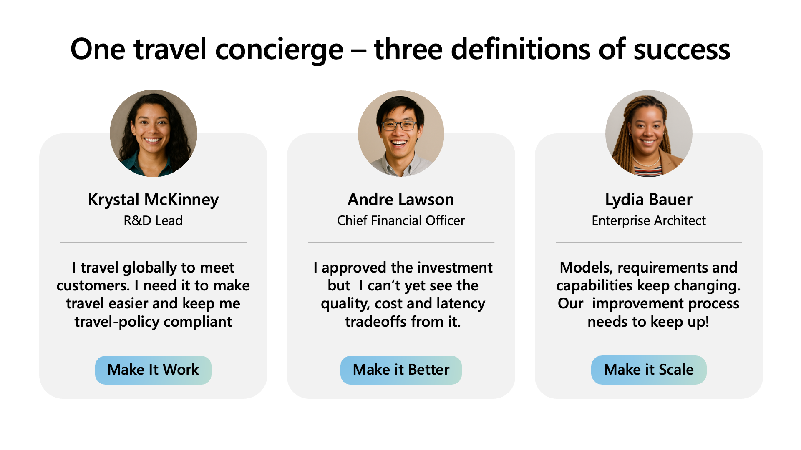

<!-- 
Image description: 
Three persona cards titled "One travel concierge – three definitions of success": Krystal McKinney, R&D Lead (Make it Work); Andre Lawson, CFO (Make it Better); and Lydia Bauer, Enterprise Architect (Make it Scale), each with a quote describing what success means to them.

Timing: 35 seconds
Cumulative: 1:15

-->

<!--
Speaker notes:
And the challenge is this: "success" depends on who you ask.

Krystal is one of the employees who uses it. She travels all over the world to meet customers. She just wants it to work, and fast, without breaking travel policy.

Andre is the CFO who pays for it. He approved the investment, and now he wants to know what he's actually getting for that money, and whether it could cost less.

And Lydia is the architect responsible for how it fits into Caldova's systems. Models and requirements keep changing, so she needs a process that can keep up.

Three people, three goals: make it work, make it better, make it scale.

Presenter Guidance:
None.
-->

---

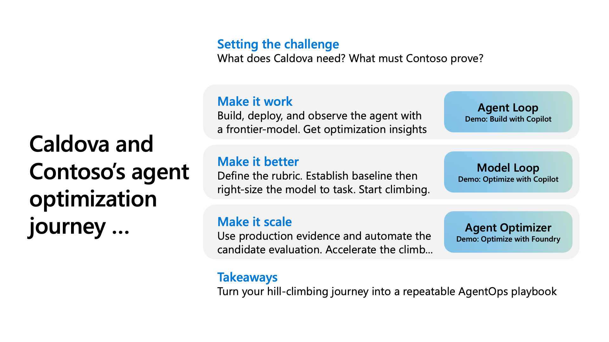

<!-- 
Image description: 
Roadmap titled "Caldova and Contoso's agent optimization journey": Setting the challenge; Make it work (Agent Loop, Demo: Build with Copilot); Make it better (Model Loop, Demo: Optimize with Copilot); Make it scale (Agent Optimizer, Demo: Optimize with Foundry); and Takeaways.

Timing: 30 seconds
Cumulative: 1:45

-->

<!--
Speaker notes:
So what does Caldova need, and how can Contoso deliver it? That's the journey we're on today.

The first goal is simply to make it work, so Krystal and her colleagues can start using it.

Then we find out where it falls short, define what good looks like, and start climbing toward better. That's for Andre.

Finally, we see how that optimization can be automated, so it scales. That's what keeps Lydia happy.

Presenter Guidance:
None.
-->

---

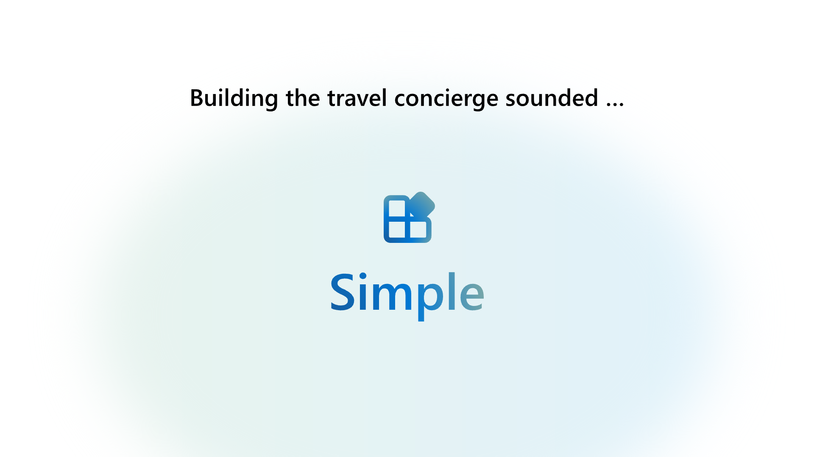

<!-- 
Image description: 
Minimal slide reading "Building the travel concierge sounded ... Simple," with a small blue application icon over a pale blue and green glow.

Timing: 25 seconds
Cumulative: 2:10

-->

<!--
Speaker notes:
But first, why is this harder than it looks?

A year ago, building something like this sounded simple. The bar was: can AI do this job at all? If it worked, we celebrated.

Today it's more complicated. Enterprises aren't just building prototypes anymore; they're putting agents into production. Environments change, outcomes have consequences, and cost and performance decide whether an agent is worth keeping.

Presenter Guidance:
Pause after "simple."
-->

---

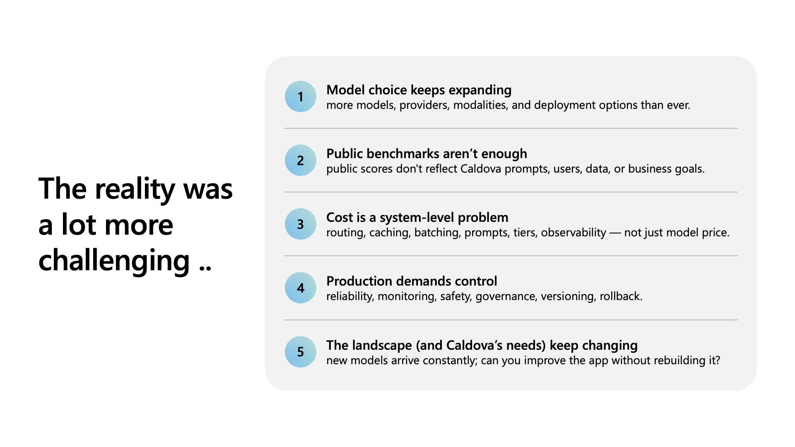

<!-- 
Image description: 
Slide titled "The reality was a lot more challenging .." listing five numbered challenges: model choice keeps expanding; public benchmarks aren't enough; cost is a system-level problem; production demands control; and the landscape (and Caldova's needs) keep changing.

Timing: 40 seconds
Cumulative: 2:50

-->

<!--
Speaker notes:
The reality is... complicated.

Model and tool choices are exploding. They're growing faster than any team can keep up with, and updates arrive almost daily.

Workload fit matters. Public benchmarks are rarely tailored to your domain, so the "best" model on a leaderboard may not be the best one for Caldova's travel policies.

Success strains the economics. Cost isn't just tokens; it's the whole system around them, and that system needs optimizing too.

Production demands governance. It's not enough to make it work. We have to make sure it's safe and compliant.

And the biggest challenge of all: the targets keep moving. So improvement can't be a one-time project. It has to be a continuous process.

Presenter Guidance:
Pause after "complicated."
-->

---

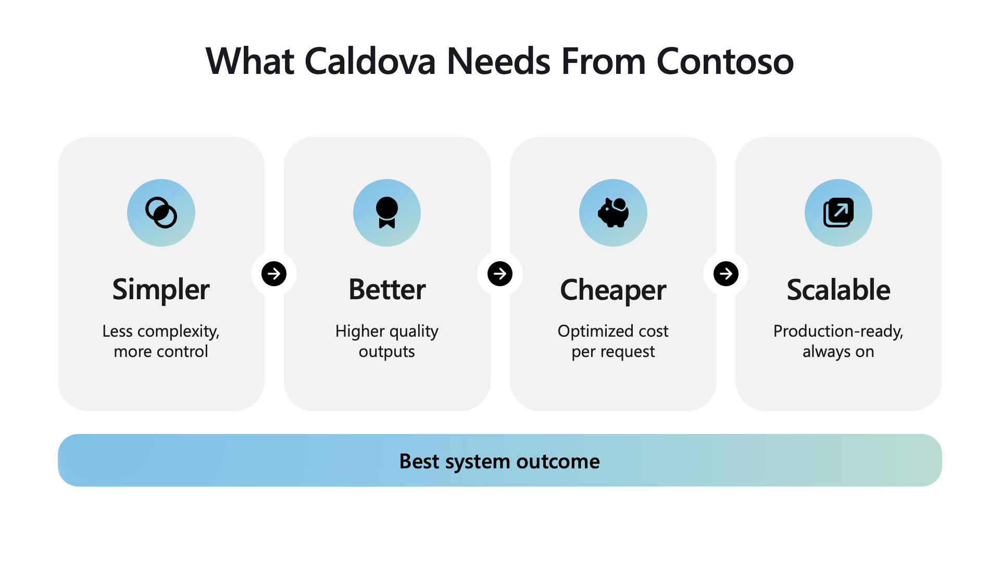

<!-- 
Image description: 
Slide titled "What Caldova Needs From Contoso" with four cards connected by arrows: Simpler (less complexity, more control), Better (higher quality outputs), Cheaper (optimized cost per request), and Scalable (production-ready, always on), above a banner reading "Best system outcome."

Timing: 40 seconds
Cumulative: 3:30

-->

<!--
Speaker notes:
So, given all that, here's what Caldova needs from Contoso.

Simpler. The complexity is handled for them, but people stay in control of the decisions.

Better. A clear definition of what "good" means, measured in Caldova's own context, not on someone else's benchmark.

Cheaper. A lower cost per request, without lowering the bar.

And scalable. Something that's maintainable in production and keeps improving as things change.

Today we'll see how GitHub Copilot, traces with Insights and rubric evaluators, Model Router, and Agent Optimizer get us there.

Presenter Guidance:
None.
-->

---

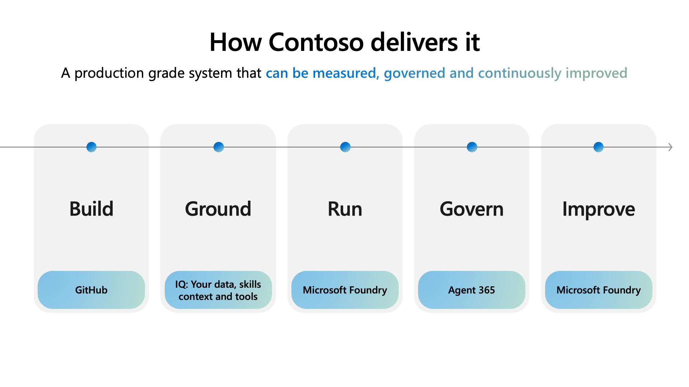

<!-- 
Image description: 
Slide titled "How Contoso delivers it" with the subtitle "A production grade system that can be measured, governed and continuously improved." A timeline of five cards: Build (GitHub), Ground (IQ: your data, skills, context and tools), Run (Microsoft Foundry), Govern (Agent 365), and Improve (Microsoft Foundry).

Timing: 30 seconds
Cumulative: 4:00

-->

<!--
Speaker notes:
So how does Contoso deliver it? With one connected platform for code and agents: GitHub and Microsoft Foundry.

They build with GitHub Copilot, run in Foundry, and then improve continuously with Foundry's agent ops tools.

Grounding and governance are covered in other AI Tour sessions, so today we'll focus on build, run, and improve.

Presenter Guidance:
Point to Build, Run, and Improve on the slide; skip Ground and Govern.
-->

---

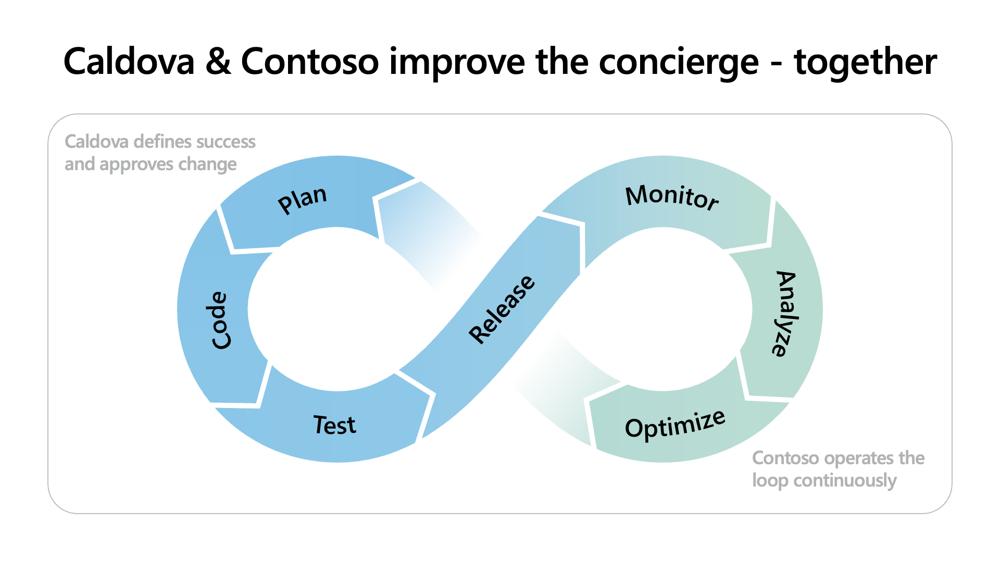

<!-- 
Image description: 
Slide titled "Caldova & Contoso improve the concierge - together" showing an infinity loop. The left loop (blue) reads Plan, Code, Test, Release, labeled "Caldova defines success and approves change." The right loop (green) reads Monitor, Analyze, Optimize, labeled "Contoso operates the loop continuously."

Timing: 30 seconds
Cumulative: 4:30

-->

<!--
Speaker notes:
Now Caldova and Contoso can work together to improve the concierge.

If you've worked in DevOps, the left side looks familiar: plan, code, test, release. The difference with agents is the right side. Monitor, analyze, optimize. An agent's behavior can shift with new models, new data, and new requests, so the work doesn't stop at release.

The roles are clear. Caldova defines what success looks like and approves every change that goes live. Contoso runs the loop continuously, watching how the agent behaves and proposing the next improvement.

Automation does a lot of the heavy lifting, but people still decide what ships.

Presenter Guidance:
Trace the loop left to right with your hand.
-->

---

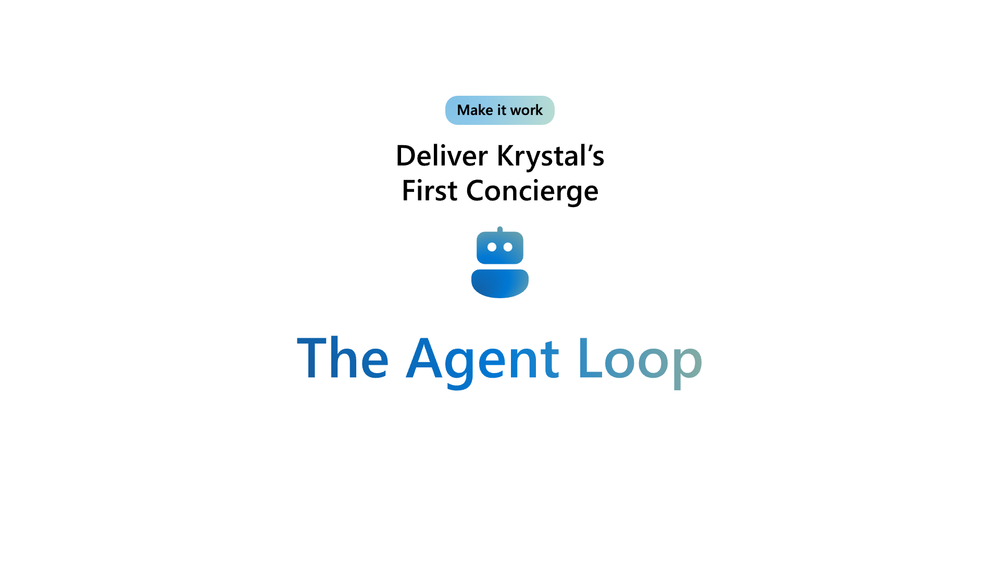

<!-- 
Image description: 
Act 1 divider with a "Make it work" label above the title "Deliver Krystal's First Concierge," a blue robot icon, and "The Agent Loop" in large gradient text.

Timing: 15 seconds
Cumulative: 4:45

-->

<!--
Speaker notes:
Now let's go build the concierge for Krystal, and see this loop in action.

It's time to make it work.

Presenter Guidance:
Pause for a beat on the slide before speaking. Land "make it work."
-->

---

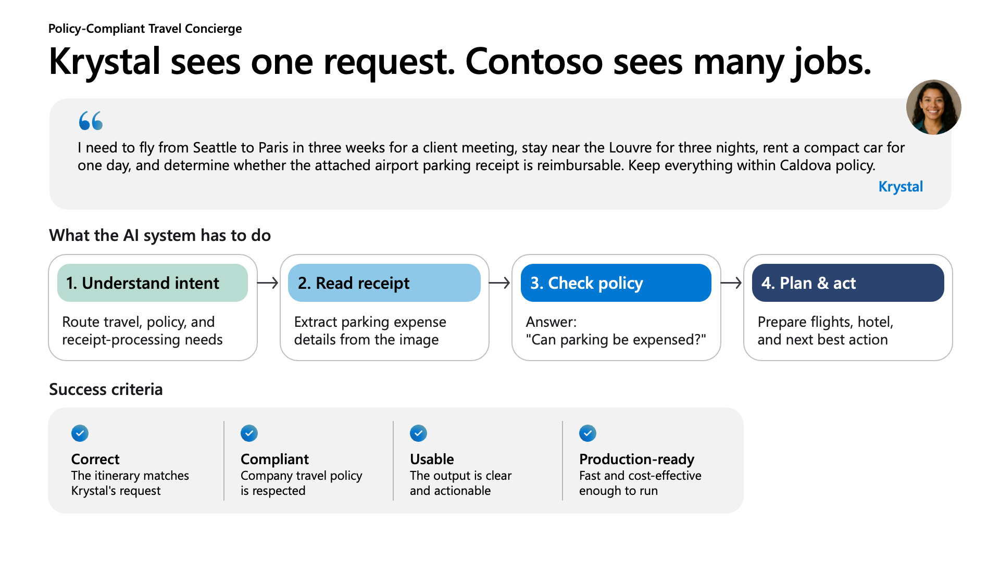

<!-- 
Image description: 
Slide titled "Krystal sees one request. Contoso sees many jobs." Krystal's quote asks to fly Seattle to Paris in three weeks, stay near the Louvre for three nights, rent a compact car for one day, and check whether an airport parking receipt is reimbursable, all within Caldova policy. Below, "What the AI system has to do" shows four steps: Understand intent, Read receipt, Check policy, Plan & act. "Success criteria" lists Correct, Compliant, Usable, and Production-ready.

Timing: 40 seconds
Cumulative: 5:25

-->

<!--
Speaker notes:
Here's Krystal's request. Flights to Paris, a hotel near the Louvre, a rental car, and a question about whether her airport parking receipt is reimbursable. All within Caldova policy.

To Krystal, that's one request. To Contoso, it's many jobs. The agent has to understand what she's asking for, read the receipt image, check the policy, and then plan and act.

Every one of those handoffs is a place where things can go wrong. So success isn't just a nice-sounding answer. It has to be correct, compliant with policy, clear enough to act on, and fast and cheap enough to run in production.

Presenter Guidance:
None.
-->

---

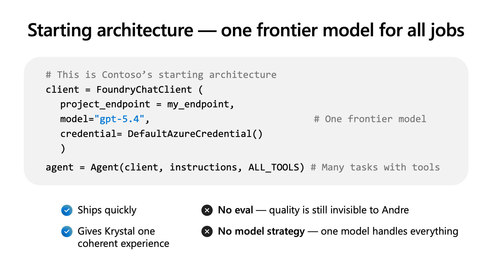

<!-- 
Image description: 
Slide titled "Starting architecture — one frontier model for all jobs." A code block shows a FoundryChatClient configured with model "gpt-5.4" (annotated "One frontier model") and an Agent created with instructions and ALL_TOOLS (annotated "Many tasks with tools"). Below: checkmarks for "Ships quickly" and "Gives Krystal one coherent experience"; X marks for "No eval — quality is still invisible to Andre" and "No model strategy — one model handles everything."

Timing: 35 seconds
Cumulative: 6:00

-->

<!--
Speaker notes:
So how does Contoso start? The way most of us do. Pick one frontier model, one of the biggest, most capable models available, give it all the tools, and let it handle every job.

Honestly, that's a sensible first move. It ships quickly, and Krystal gets one consistent experience.

But there are two gaps.

First, Andre can't see the quality he's paying for. There's no way yet to evaluate what "good" means.

Second, there's no model strategy. One model does everything, so we may be using a race car to do a bike's job.

It's a good place to start. It's just not where we want to stop.

Presenter Guidance:
Don't read the code line by line. Prep: review src/agent/main.py and src/agent/tools/definitions.py.
-->

---

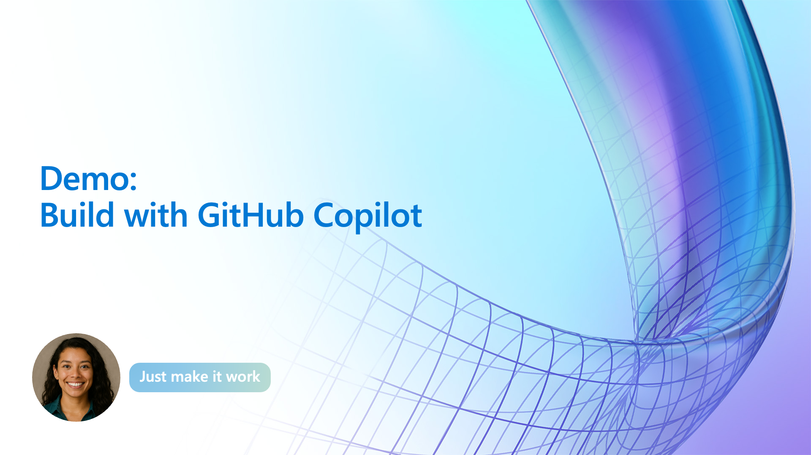

<!-- 
Image description: 
Demo divider reading "Demo: Build with GitHub Copilot" over a blue and violet ribbon graphic. Krystal's photo sits in the lower left beside a "Just make it work" label.

Timing: 20 seconds
Cumulative: 6:20

-->

<!--
Speaker notes:
So let's get Krystal something she can use. Remember, for her the bar is simple: just make it work.

GitHub Copilot will walk us through building the agent and deploying it to Foundry. Then we'll put it in front of Krystal and see what happens.

Presenter Guidance:
Have CLIP01-RUN ready on the next slide.
-->

---

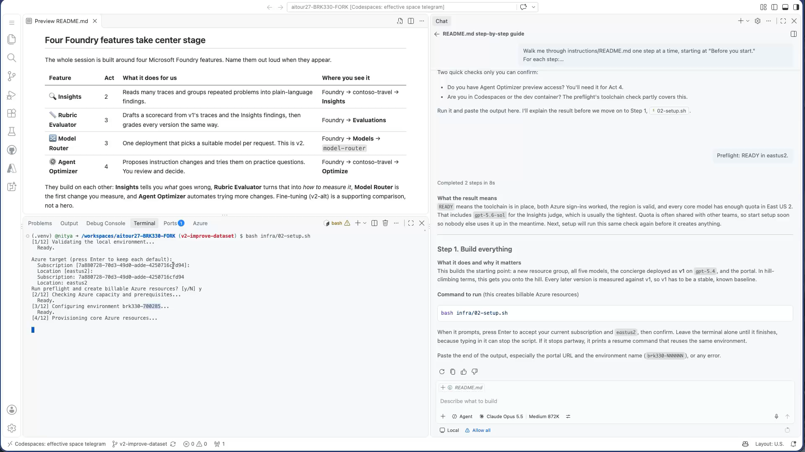

<!-- 
Image description: 
VS Code screenshot. On the left, a README preview titled "Four Foundry features take center stage" lists Insights, Rubric Evaluator, Model Router, and Agent Optimizer. On the right, Copilot Chat walks through the guide step by step and is at "Step 1. Build everything," which runs infra/02-setup.sh.

Timing: 70 seconds
Cumulative: 7:30

-->

<!--
Speaker notes:
We start where a lot of developers start: in VS Code, with Copilot. We ask it to walk us through the session guide, and the first step is "build everything."

Copilot explains what this step does and gives us the command to run: one setup script. At its heart is one tool, the Azure Developer CLI, or azd. It takes us all the way from provisioning to deployment: the Foundry project and models, the permissions the agent needs, the concierge as a hosted agent, and the employee portal that talks to it.

And here's the thing. I didn't need to know azd, or Foundry's APIs, before I started. Copilot knows them, either through Foundry skills or by writing the SDK code for us. If a step fails, we paste in the error and fix it together, right there in the conversation.

And just like that, Krystal has something she can try.

Presenter Guidance:
Play CLIP01-RUN (1:07). Keep infra/02-setup.sh open in a VS Code tab in case you want to show it. Focus on two points: azd is the single tool behind the script, from provisioning (azd provision) to deployment (azd deploy); and you don't need to know the details ahead of time. The clip is sped up. Real provisioning takes longer and creates billable Azure resources.
-->

---

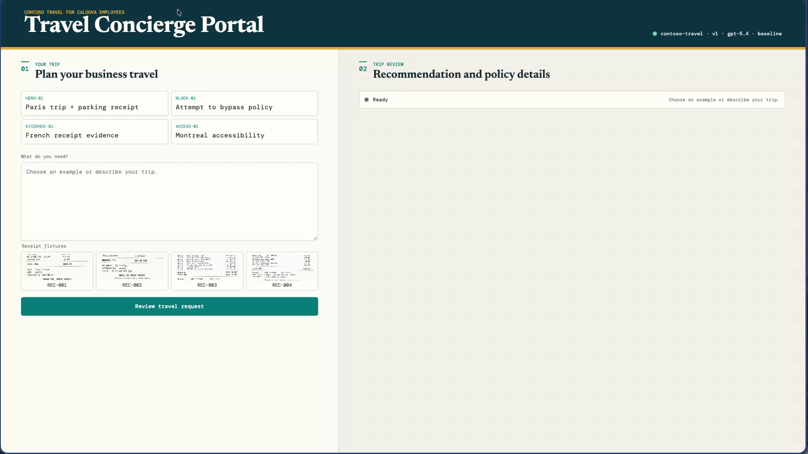

<!-- 
Image description: 
The Contoso Travel Concierge Portal, running v1 on gpt-5.4 as the baseline. Four sample scenarios: Paris trip plus parking receipt, attempt to bypass policy, French receipt evidence, and Montreal accessibility. Krystal's Paris request is loaded, with receipt fixtures REC-001 to REC-004 underneath and an empty "Recommendation and policy details" panel on the right.

Timing: 75 seconds
Cumulative: 8:45

-->

<!--
Speaker notes:
So let's put it in front of Krystal. We have a few of her requests here, so let's try them out.

First, her Paris trip, with the parking receipt. The agent gets to work. It searches flights, hotels, and cars, and checks the receipt. And then... the booking doesn't happen. The agent can't show that the policy check passed, so it stops.

Not what Krystal wanted. But it's not all bad news. When someone tries to bypass policy, the agent correctly refuses. It can read a receipt written in French. And when nothing matches a request, it says so instead of making something up.

So some things work, and one important thing doesn't. Okay, it works. But we can see it isn't perfect.

Presenter Guidance:
Play CLIP02-PORTAL (1:08). Don't read the responses aloud. Let the failed booking land before you move on to what worked. The last two requests (French receipt and Montreal accessibility) go by quickly; one line each is enough.
-->

---

<!-- 
Image description: 
Andre's photo above an "Andre's CFO Math" label. Large text reads "$11,400 — Modeled annual costs for concierge." Three figures below: Avg Cost Per Request $0.019, Requests per month 50,000, and Quality: not measured "?". Footnote: based on GPT-5.4 Global Standard list pricing of about $2.50 per million input tokens and $15 per million output tokens, applied to the observed workload's token mix.

Timing: 30 seconds
Cumulative: 9:15

-->

<!--
Speaker notes:
And it isn't just Krystal who's noticed. Andre has been doing the math.

About two cents per request, fifty thousand requests a month. That's roughly eleven thousand four hundred dollars a year.

Not bad.

But he can see the cost, and he can't see the return. Is the agent getting things right? When it doesn't, why not? Right now, we can't tell him.

Presenter Guidance:
Pause after "Not bad." These figures were calculated from the traces of 108 requests, using the frontier model pricing shown in the footnote.
-->

---

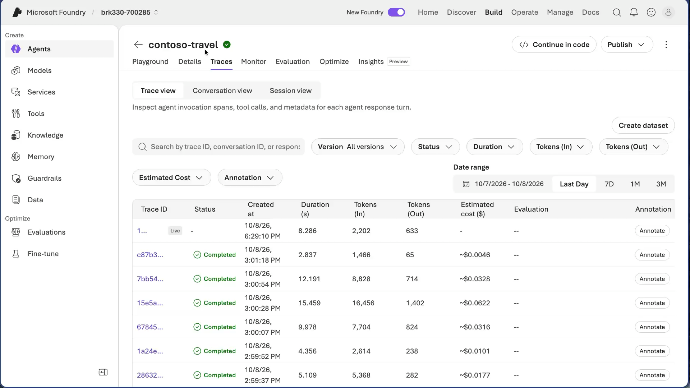

<!-- 
Image description: 
Microsoft Foundry, contoso-travel agent, Traces tab. Filters for version, status, duration, tokens, estimated cost, and annotation. A table lists recent traces with ID, status, created time, duration, tokens in and out, and estimated cost per run.

Timing: 50 seconds
Cumulative: 10:05

-->

<!--
Speaker notes:
This is where traces help.

Every time someone sends the concierge a request, Foundry records what happened. Which model calls were made. Which tools were called, and in what order. How many tokens each step used, and how long each step took.

Let's open one up. This is a simple request: rent a compact car in Berlin. And look at the top: twenty-seven steps, ten model calls, four tool calls. For one car. Each step is a span, and we can see exactly what went into it and what came out.

And here's something interesting. The answer says the policy check "passed," but no policy rule was cited. Keep that in mind.

That's one run. But Caldova will have thousands.

Presenter Guidance:
Play CLIP03-TRACES (0:41). Point to the tokens, latency, and cost columns, then to the span and call counts at the top right of the open trace (27 spans, 10 chat calls, 4 tool calls). Land the "passed, but no rule cited" detail; it foreshadows the policy hard-gate insight on slide 21. Tracing is generally available; Trace Replay (the timeline at the bottom) is in preview.
-->

---

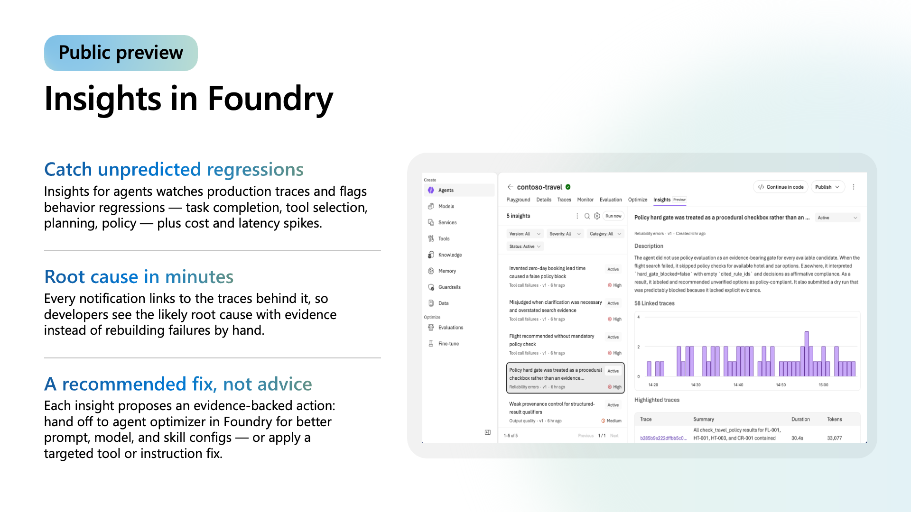

<!-- 
Image description: 
"Public preview" badge above the title "Insights in Foundry." Three points on the left: "Catch unpredicted regressions" (watches production traces and flags behavior regressions in task completion, tool selection, planning, and policy, plus cost and latency spikes); "Root cause in minutes" (every notification links to the traces behind it); and "A recommended fix, not advice" (hand off to Agent Optimizer for better prompt, model, and skill configs, or apply a targeted tool or instruction fix). On the right, a Foundry screenshot of the contoso-travel agent's Insights tab lists 5 insights; the selected policy hard-gate insight shows 58 linked traces.

Timing: 30 seconds
Cumulative: 10:35

-->

<!--
Speaker notes:
Nobody's going to read thousands of traces one by one. That's where Insights in Foundry comes in.

Most testing starts from a specification: we decide up front what to check. Insights starts from evidence. It looks at what the agent actually did across real traces, finds the patterns that matter, and links each one back to the traces behind it.

So let's send our concierge a batch of realistic questions, let the traces pile up, and then ask for Insights.

Presenter Guidance:
Land the contrast between specification and evidence. No clip on this slide; CLIP04-QUESTIONS plays on the next one. Insights in Foundry is in public preview.
-->

---

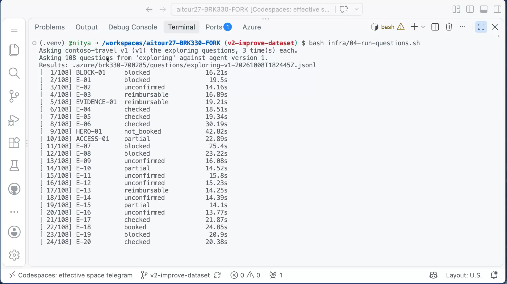

<!-- 
Image description: 
VS Code with the terminal running bash infra/04-run-questions.sh: 108 of 108 exploring-question runs complete. Copilot Chat summarizes the results in a table by difficulty (easy, medium, hard; 36 questions each), with outcomes, latency, tokens, and tool use, and notes that the traces are now ready for Insights.

Timing: 35 seconds
Cumulative: 11:10

-->

<!--
Speaker notes:
Here are the questions going through, from simple lookups to tricky multi-step trips. Over a hundred of them: thirty-six each of easy, medium, and hard.

And every run lands in Traces, with its duration, tokens in and out, and estimated cost. That's the raw material Insights works from. So now, let's ask Foundry what it sees.

Presenter Guidance:
Play CLIP04-QUESTIONS (0:24). When the Traces list appears, point to the Duration, Tokens, and Estimated cost columns. Have CLIP05-INSIGHTS ready on the next slide.
-->

---

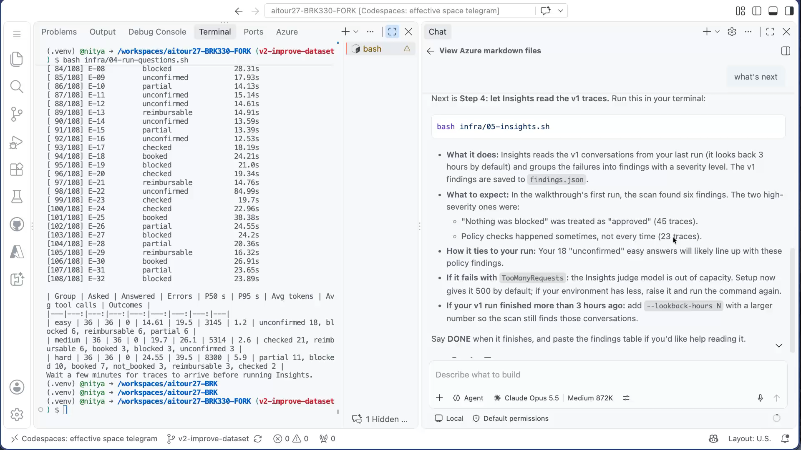

<!-- 
Image description: 
Microsoft Foundry, contoso-travel agent, Insights tab (preview). Five active insights are listed with category and severity: Invented zero-day booking lead time caused a false policy block (tool call failures, high); Misjudged when clarification was necessary and overstated search evidence (tool call failures, high); Flight recommended without mandatory policy check (tool call failures, high); Policy hard gate was treated as a procedural checkbox rather than an evidence-bearing gate (reliability errors, high); and Weak provenance control for structured-result qualifiers (output quality, medium). The selected insight shows a description, a linked-traces chart over time, and a highlighted traces table.

Timing: 80 seconds
Cumulative: 12:30

-->

<!--
Speaker notes:
What comes back isn't a pile of traces. It's five insights, each with a category and a severity. Four are high severity.

Each one tells a story. In one, the agent invented a booking lead time of zero days, and then blocked a perfectly valid trip because of it. In another, it recommended a flight without ever running the mandatory policy check.

And then there's the big one: a reliability error across fifty-eight traces. Remember the trace we opened, where the policy check "passed" but no rule was cited? This is that pattern, everywhere. The agent treated "not blocked" as "compliant," instead of getting real evidence from the policy check. A box to tick, not a gate it had to prove it passed. And without that evidence, bookings like Krystal's get stopped.

For every insight, we get a plain-language description, a chart of when it happened, and links straight to the traces behind it. And Insights goes one step further: each one comes with a recommended fix we can review.

One more thing worth noticing. Insights itself runs on a model we deploy, and that model does the heavy reading across all those traces. Here, it made a couple of hundred calls and read millions of tokens. We picked one of our strongest models for quality, but it has a cost too. So this is one more place we could optimize later, by trying a cheaper model and checking the insights still hold up.

So we made it work. And now we know exactly where its behavior falls short. Time to make it better.

Presenter Guidance:
Play CLIP05-INSIGHTS (1:02). Walk the insights list top to bottom: point to the category and severity on each, then the linked-traces chart and the highlighted traces table. Pause on the policy hard-gate insight and its 58 linked traces, and make the callback to the trace on slide 18. The recommended fixes aren't shown in the clip; mention them in one line. At the end of the clip, the insights-judge deployment's Monitor tab shows what the analysis itself cost: talk about the trend, not the figure, and don't read out the model SKU name. The real analysis takes longer than this edited recording. Insights in Foundry is in public preview. If asked: zero-day lead time (1 trace), misjudged clarification (10), flight without policy check (4), policy hard gate (58), weak provenance (medium); insights-judge made 172 requests, about 3.9M tokens, about $36 estimated.
-->

---

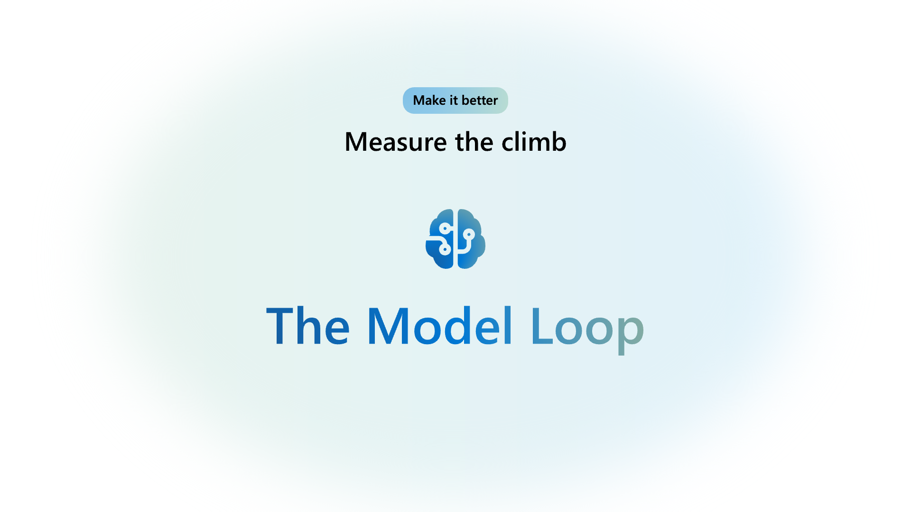

<!-- 
Image description: 
Section divider with a "Make it better" label above the title "Measure the climb" and "The Model Loop" in large gradient text.

Timing: 20 seconds
Cumulative: 12:50

-->

<!--
Speaker notes:
So that's Act 1. We made it work for Krystal.

Now Act 2: making it better for Andre. Better quality, at a cost he can justify.

And to do that, we're going to use the analogy of hill climbing.

Presenter Guidance:
Pause on the slide for a beat before speaking.
-->

---

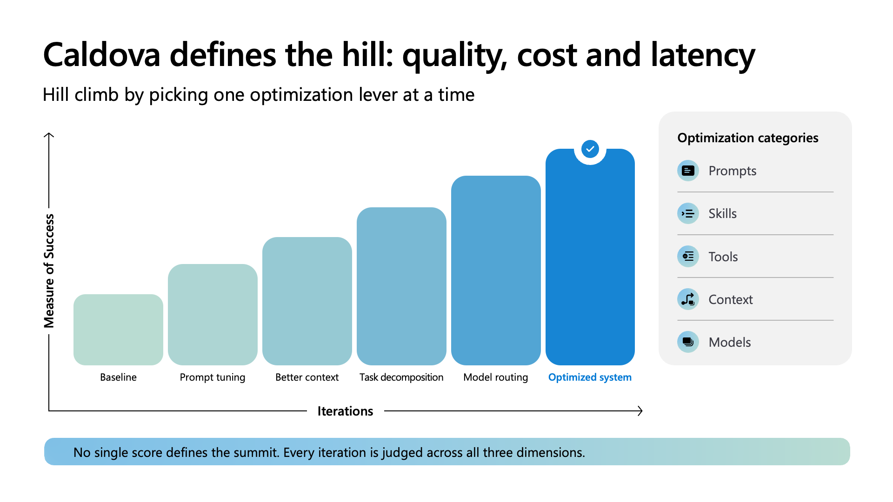

<!-- 
Image description: 
Slide titled "Caldova defines the hill: quality, cost and latency." A rising bar chart climbs from Baseline through Prompt tuning, Better context, Task decomposition, and Model routing to Optimized system. Alongside it, five optimization categories that can be applied one step at a time.

Timing: 40 seconds
Cumulative: 13:30

-->

<!--
Speaker notes:
Here's how hill climbing works. We start at the bottom: our baseline. Caldova decides what the top looks like, with targets for quality, cost, and latency.

Then we climb one step at a time. Change one thing, like the prompt, the context, how the task is broken down, or which model handles it. Measure the result. If it moved us uphill, we keep it. If not, we step back and try something else.

One change at a time, so we always know what made the difference.

But "uphill" isn't one number. We're tracking quality, cost, and latency, and quality itself has many parts. So we need a way to measure across multiple dimensions at once.

Presenter Guidance:
Walk the bars from left to right. This shows a method. Not every step will go up.
-->

---

<!-- 
Image description: 
"Public preview" badge above the title "Rubric evaluator (define what 'good' means)." Three points on the left: "Right evals at the right time, automatically" (when you create an agent in Foundry, a context-aware rubric is generated to match your agent's domain and use case); "No more writing evals from scratch" (the system distills your agent context into an out-of-the-box rubric and test dataset); and "Seamless offline-to-online eval pipeline" (create, run in dev, graduate to production traces, repeat). On the right, a Foundry Evaluations screenshot of a rubric-based evaluator for contoso-travel, drafted from v1 traces, Insights findings, and guidance, then reviewed and locked by a person. Seven weighted dimensions: policy_gate_compliance (10), tool_grounding (6), numeric_reconciliation (6), partial_completion_handling (5), specificity_under_underspecification (4), clear_actionable_response (2), and general_quality (5). Overall score range 0 to 1; dimension score range 1 to 5.

Timing: 40 seconds
Cumulative: 14:10

-->

<!--
Speaker notes:
That's what a multi-dimensional rubric gives us, and Foundry's Rubric Evaluator builds one for us.

Writing evaluations from scratch is slow, and it's easy to miss what matters. Here, Foundry reads the agent's context, its traces, and what Insights found, and drafts a rubric for this specific job. Each dimension says what good behavior looks like, and has a weight that reflects how much it matters.

All of that rolls up into one score we can track as we climb. And because it's a rubric, we can see which dimension moved, not just that the number changed. Cost and latency come straight from the traces, so we see all three together.

The same rubric works in development and in production, so the way we measure doesn't change when we ship.

Presenter Guidance:
Point to the weighted dimensions in the screenshot. Rubric Evaluator is in public preview. A person reviews and locks the rubric before any scoring.
-->

---

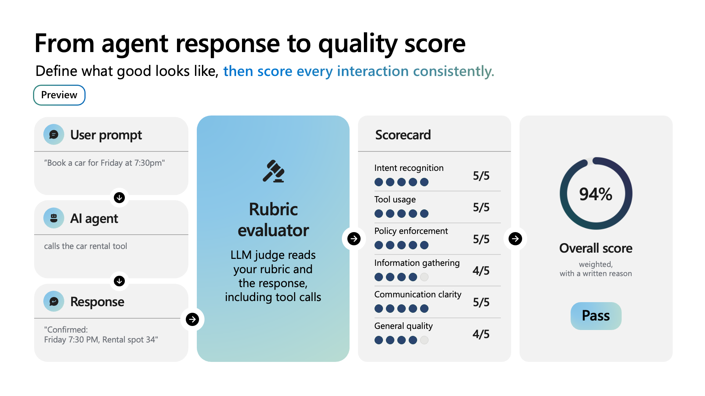

<!-- 
Image description: 
Slide titled "From agent response to quality score" with the subtitle "Define what good looks like, then score every interaction consistently," and a Preview badge. Left to right: a User prompt ("Book a car for Friday at 7:30pm"), the AI agent (calls the car rental tool), and the Response ("Confirmed: Friday 7:30 PM, Rental spot 34"). These feed the Rubric evaluator ("LLM judge reads your rubric and the response, including tool calls"), which produces a Scorecard: Intent recognition 5/5, Tool usage 5/5, Policy enforcement 5/5, Information gathering 4/5, Communication clarity 5/5, General quality 4/5. The final panel shows an Overall score of 94 percent, "weighted, with a written reason," and a Pass label.

Timing: 30 seconds
Cumulative: 14:40

-->

<!--
Speaker notes:
Here's a simple example of how a rubric scores a single request.

Someone asks to book a car for Friday at 7:30. The agent calls the rental tool and confirms the booking. The rubric evaluator uses an LLM as a judge. It reads the response, including the tool calls, and scores each dimension.

Those scores roll up into one weighted result, here 94 percent and a pass, with a written reason we can check.

And because every response is scored the same way, with the same rubric and the same judge, we can compare one version of the agent with the next and know whether we actually moved uphill.

Presenter Guidance:
Walk the slide from left to right. The score is a consistent measure, not absolute truth.
-->

---

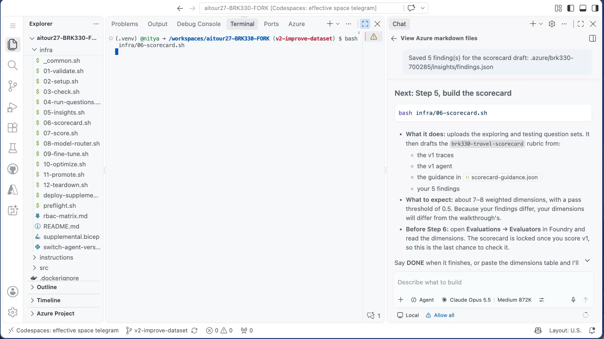

<!-- 
Image description: 
VS Code with Copilot Chat. Copilot confirms it saved the five Insights findings and moves to "Step 5: Build the scorecard," which runs infra/06-scorecard.sh. It explains the script drafts a rubric of about seven weighted dimensions with a pass threshold of 0.5, and asks for review in Foundry (Evaluations > Evaluators) before Step 6, because the scorecard is locked once v1 is scored.

Timing: 75 seconds
Cumulative: 15:55

-->

<!--
Speaker notes:
So let's build that rubric for our concierge.

We ask Copilot for help, and it gives us one script to run. Copilot wrote that script using the Foundry SDK. It uploads our question sets and asks Foundry to draft a rubric from everything we know so far: the v1 traces, the agent itself, Caldova's guidance, and the five Insights findings.

We could also have Copilot use a predefined skill instead. The Microsoft Foundry skill's "observe" workflow knows how to generate a rubric evaluator straight from the agent or its traces. Either way, we didn't need to know the evaluator API ahead of time, and if something breaks, Copilot helps us debug it.

What comes back is seven weighted dimensions, each scored one to five, rolled up into one overall score. And you can see Insights all over it. Right at the top, with the highest weight, is policy-gate compliance: only treat an option as allowed when the policy tool clearly supports it. That's our fifty-eight traces, and the reason Krystal's booking failed. Tool grounding: don't invent rules or prices. Specificity: don't make up a missing booking lead time. Every dimension reads like a lesson from those traces.

And at the bottom, general quality. It's always applied, as a catch-all for anything the other dimensions miss.

Before we use it, a person reviews it in Foundry. Once we score the first version, the rubric is locked, so every later step is measured the same way.

Presenter Guidance:
Play CLIP06-RUBRICS (1:07). Keep src/scripts/build_scorecard.py open in case you want to show the SDK call (begin_create_generation_job, around line 142). On the evaluator page, point to policy_gate_compliance (weight 10) at the top, then tool_grounding and specificity_under_underspecification as the links back to Insights, then general_quality marked "Always applicable." Rubric Evaluator is in public preview. If asked: weights 10, 6, 6, 5, 4, 2, 5; overall score 0–1, each dimension 1–5; evaluated per turn and per conversation. The judge model is gpt-5.4-mini, a smaller model, which keeps scoring cheap. The script also saves the rubric as a JSON file under .azure/<env>/scorecard/, so it can be reviewed in the repo as well as in Foundry. Datasets: 108 exploring questions were run against v1 (36 easy, 36 medium, 36 hard); the exploring dataset uploaded for the rubric holds 36 of them; 24 separate testing questions are used for scoring.
-->

---

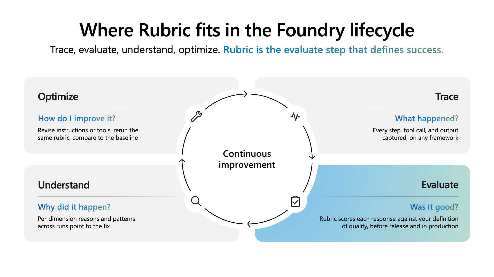

<!-- 
Image description: 
Slide titled "Where Rubric fits in the Foundry lifecycle," subtitle "Trace, evaluate, understand, optimize. Rubric is the evaluate step that defines success." A continuous-improvement circle runs clockwise through four cards: Trace ("What happened?" every step, tool call, and output captured, on any framework); Evaluate, highlighted ("Was it good?" rubric scores each response against your definition of quality, before release and in production); Understand ("Why did it happen?" per-dimension reasons and patterns across runs point to the fix); and Optimize ("How do I improve it?" revise instructions or tools, rerun the same rubric, compare to the baseline).

Timing: 25 seconds
Cumulative: 16:20

-->

<!--
Speaker notes:
And now you can see the loop come into focus.

Traces tell us what happened. The rubric tells us whether it was good. The reasons behind each dimension score tell us why. Then we make one change, rerun the same rubric, and compare with where we started.

Remember the right side of that DevOps loop from earlier? Monitor, analyze, optimize. This is it, with a clear definition of "good" built in.

There's just one thing missing: a starting score. So let's evaluate our baseline.

Presenter Guidance:
Trace the circle clockwise from Trace to Optimize. Evaluate is highlighted because that's the step we just added.
-->

---

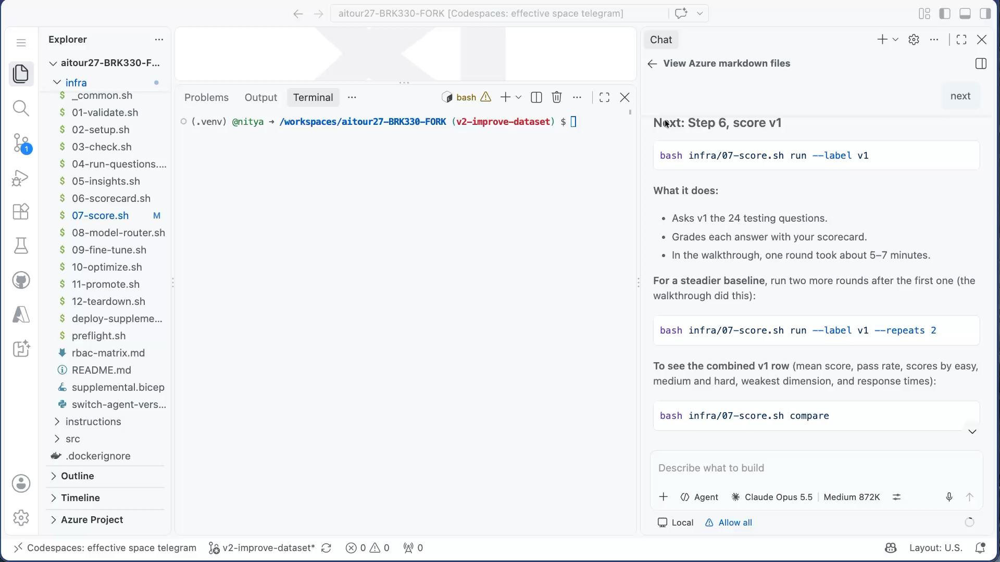

<!-- 
Image description: 
VS Code with Copilot Chat. After a checkpoint ("this is your last chance to change the scorecard"), Copilot shows "Next: Step 6, score v1" with the command bash infra/07-score.sh run --label v1. It explains that the step asks v1 the 24 testing questions, grades each answer with the scorecard, and takes about 5–7 minutes per round. For a steadier baseline, it suggests two more rounds with --repeats 2, then shows how to view the combined v1 row.

Timing: 115 seconds
Cumulative: 18:15

-->

<!--
Speaker notes:
Copilot gives us one last checkpoint. This is our final chance to change the rubric. After this, it's locked.

Then it gives us the command to score version one. The agent answers twenty-four testing questions it hasn't seen before, and the rubric grades every answer.

And we don't do this just once. Agents don't give the same answer every time. Look at the three rounds: the pass rate moves a few points from one round to the next. So we average them. That gives us a baseline we can trust, not one lucky or unlucky run.

As the results come in, we can open any response and see the score for each dimension, with the judge's reason. Here's one that passed: a flight search with no matches, and the agent said so without making anything up. Policy-gate compliance doesn't even apply here, so the rubric marks it "not applicable" instead of guessing. And here's one that failed. The lowest score? Policy-gate compliance, one out of five. The same problem Insights found, now measured.

So here's our baseline: a quality score of 0.70 and a 90 percent pass rate. And for the first time, Andre's question mark has a number. This is the bottom of the hill. Every step from here gets compared with this.

Presenter Guidance:
Play CLIP07-SCORE (1:47). The passing example is the Seattle flights request (Pass 0.750); the failing example is the Toronto request (Fail 0.289). Leave the final scorecard visible for a beat. The 24 testing questions are separate from the questions used to build the rubric. The clip is sped up; one round takes about 5–7 minutes. If asked: the three v1 rounds passed 92%, 92%, and 88% (average 90%). We run three rounds for the baseline; later versions use two rounds to save time and tokens, though three is always an option.
-->

---

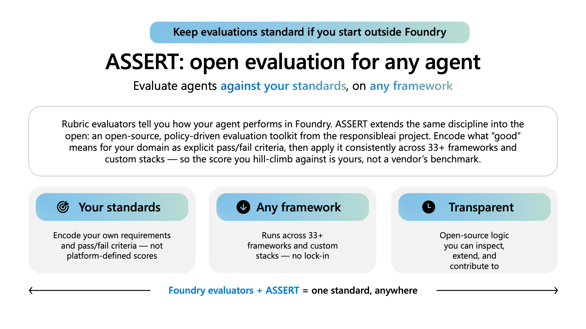

<!-- 
Image description: 
Banner reading "Keep evaluations standard if you start outside Foundry" above the title "ASSERT: open evaluation for any agent," subtitle "Evaluate agents against your standards, on any framework." A text panel explains that ASSERT is an open-source, policy-driven evaluation toolkit from the responsibleai project: encode what "good" means for your domain as explicit pass/fail criteria, then apply it across 33+ frameworks and custom stacks. Three cards: Your standards (your own requirements and pass/fail criteria, not platform-defined scores); Any framework (33+ frameworks and custom stacks, no lock-in); and Transparent (open-source logic you can inspect, extend, and contribute to). Footer: "Foundry evaluators + ASSERT = one standard, anywhere."

Timing: 30 seconds
Cumulative: 18:45

-->

<!--
Speaker notes:
Now, you might be thinking: that's great, but my agent doesn't run in Foundry.

That's okay. ASSERT is an open-source evaluation toolkit from the responsibleai project. You write down what "good" means for your domain as clear pass/fail criteria, and apply them the same way across more than thirty-three frameworks and custom stacks.

So the score you climb against belongs to you, not to a vendor. And if you later bring the agent into Foundry, your definition of "good" comes with you.

Presenter Guidance:
Keep it brief. This slide is about portability; the demo stays in Foundry.
-->

---

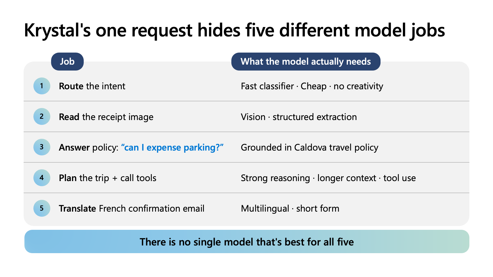

<!-- 
Image description: 
Slide titled "Krystal's one request hides five different model jobs." A two-column table, "Job" and "What the model actually needs": 1. Route the intent (fast classifier, cheap, no creativity); 2. Read the receipt image (vision, structured extraction); 3. Answer policy, "can I expense parking?" (grounded in Caldova travel policy); 4. Plan the trip and call tools (strong reasoning, longer context, tool use); 5. Translate French confirmation email (multilingual, short form). Banner: "There is no single model that's best for all five."

Timing: 35 seconds
Cumulative: 19:20

-->

<!--
Speaker notes:
So let's recap. We made it work. We defined what "good" looks like with an evaluator. And we know the baseline score for our climb.

Now we need to make one change to start the climb. What could that be?

Well, remember that second gap from the start? One frontier model doing every job. Let's look at Krystal's request again. It's really five different jobs.

Working out what she wants just needs a fast, cheap classifier. Reading the receipt needs vision. And planning the trip needs strong reasoning and tool use.

There's no single model that's best for all five. So our first step up the hill is the model itself.

Presenter Guidance:
Pause after "What could that be?" Point to the three rows you mention; let the slide carry the other two.
-->

---

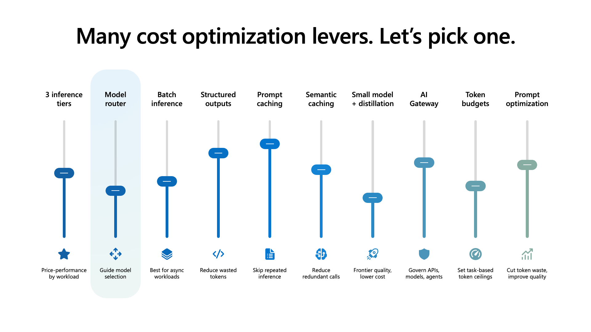

<!-- 
Image description: 
Slide titled "Many cost optimization levers. Let's pick one." Ten vertical sliders, each with an icon and a short caption: 3 inference tiers (price-performance by workload); Model router, highlighted (guide model selection); Batch inference (best for async workloads); Structured outputs (reduce wasted tokens); Prompt caching (skip repeated inference); Semantic caching (reduce redundant calls); Small model + distillation (frontier quality, lower cost); AI Gateway (govern APIs, models, agents); Token budgets (set task-based token ceilings); and Prompt optimization (cut token waste, improve quality).

Timing: 30 seconds
Cumulative: 19:50

-->

<!--
Speaker notes:
And there are a lot of ways to change the model side of things. Caching, batching, token budgets, distillation, and more. Each one is a lever we could pull.

But we said one change at a time. So we pick the one that matches our gap: Model Router.

Model Router is a single deployment in Foundry. Instead of sending every request to one frontier model, it looks at each request and picks a model that fits. Smaller, cheaper models where they're enough, and stronger ones where the work needs them.

And the best part: the agent doesn't change. Same instructions, same tools. We just point it at the router, rerun the same rubric, and see if we moved uphill.

Presenter Guidance:
Don't explain every lever. Point to the highlighted Model Router column. Distillation comes back a few slides later.
-->

---

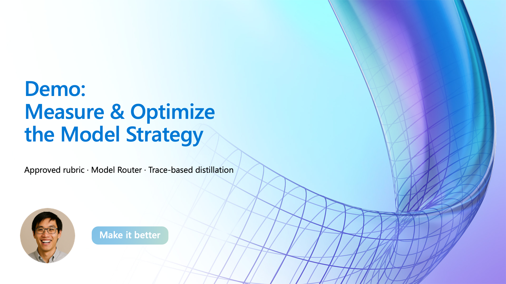

<!-- 
Image description: 
Demo divider reading "Demo: Measure & Optimize the Model Strategy," with the subtitle "Approved rubric · Model Router · Trace-based distillation," over a blue and violet ribbon graphic. Andre's photo sits in the lower left beside a "Make it better" label.

Timing: 15 seconds
Cumulative: 20:05

-->

<!--
Speaker notes:
We made it work with a frontier model. Now let's see if we can make it better by changing just the model.

We have an approved rubric and a baseline. Now let's swap in Model Router, and then look at one more model lever, distillation.

Same rubric, same questions, one change. Let's see where it takes us.

Presenter Guidance:
Keep it quick. Have CLIP08-ROUTER-DEFAULT ready on the next slide. The subtitle lists trace-based distillation: it isn't in the recorded demo, but the session repo includes the lab (infra/09-fine-tune.sh) for anyone who wants to try it.
-->

---

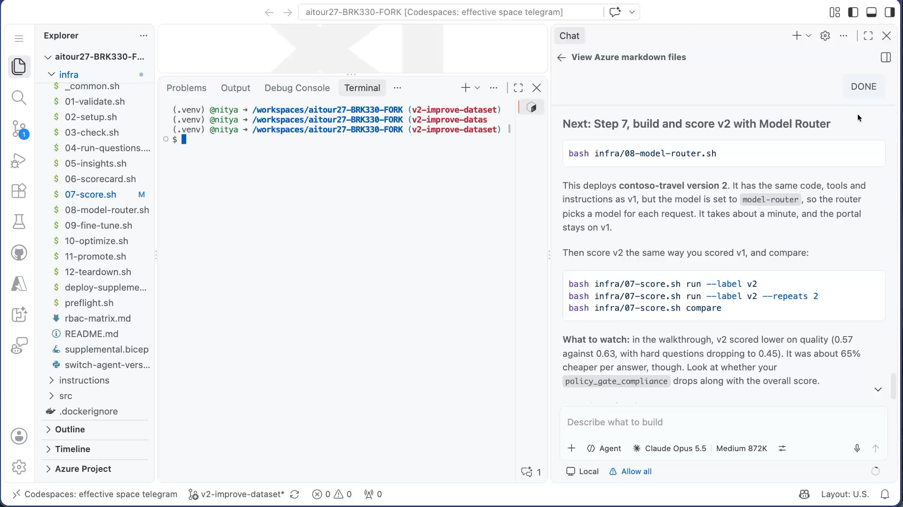

<!-- 
Image description: 
VS Code with Copilot Chat at "Next: Step 7, build and score v2 with Model Router," with the command bash infra/08-model-router.sh. Copilot explains that this deploys contoso-travel version 2 with the same code, tools, and instructions as v1, but with the model set to model-router, so the router picks a model for each request. It takes about a minute, and the portal stays on v1. It then shows how to score v2 the same way as v1 (07-score.sh run --label v2, two more rounds with --repeats 2, then compare). A "What to watch" note says to check whether policy_gate_compliance drops along with the overall score.

Timing: 65 seconds
Cumulative: 21:10

-->

<!--
Speaker notes:
Copilot gives us the next command. It deploys version two: same code, same tools, same instructions. The only change is the model, which is now Model Router, in its default, balanced mode. And the portal stays on version one, so Krystal isn't affected while we experiment.

Then we score it the way we scored version one. Same questions, same rubric. This time two rounds, to save time and tokens.

So, did we move uphill? Not really. Overall quality is about the same. A little better on medium questions, a little worse on the hard ones. And it's slower, and uses more tokens.

But look at the Monitor tab. The router is spreading the work across a mix of smaller models, priced well below our frontier model. So even with more tokens, the bill goes down. Andre's going to like that.

What hasn't moved is policy-gate compliance, our weakest dimension. Which makes sense: changing who picks the model doesn't fix a policy-reasoning problem.

So cheaper, but not better. That's exactly why we measure every step.

Presenter Guidance:
Play CLIP08-ROUTER-DEFAULT (0:50). Talk about the trend, not the exact numbers. Pause on the comparison table (quality flat, hard questions down, policy_gate_compliance unchanged), then show the Monitor tab's cost breakdown by model. If asked: v1 0.70 / 90% vs v2 0.68 / 87%; tokens per answer up 44%; P50 latency 10.0 s to 14.4 s.
-->

---

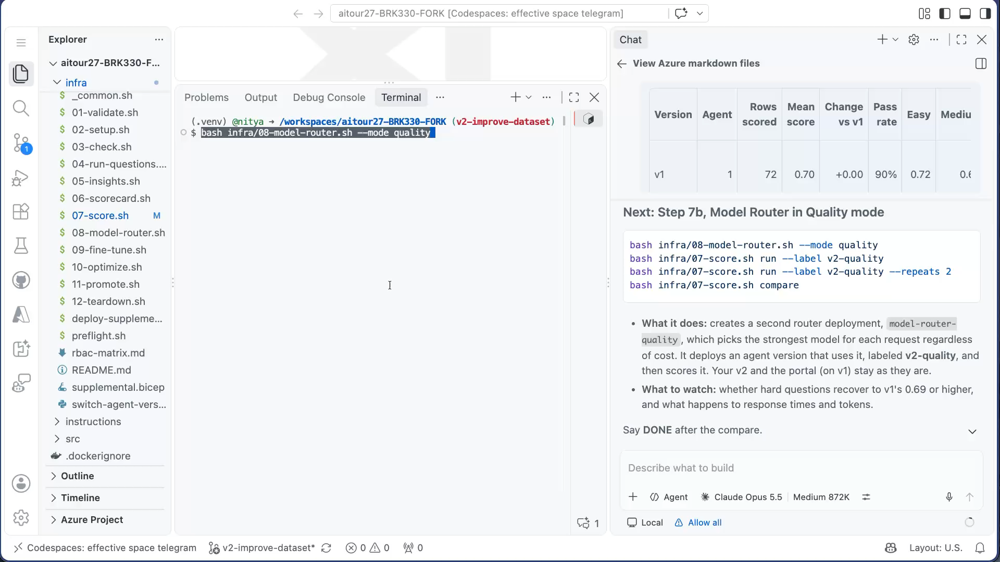

<!-- 
Image description: 
VS Code with Copilot Chat showing a comparison table for v1 (gpt-5.4) and v2 (Model Router, Balanced): overall score, pass rate, scores by difficulty, and per-dimension rubric scores. The clip continues with a v2-quality run using a second Model Router deployment set to prioritize quality, a three-way comparison table (v1, v2 Balanced, v2-quality), and the model-router-quality Monitor tab in Foundry showing estimated cost by model.

Timing: 70 seconds
Cumulative: 22:20

-->

<!--
Speaker notes:
So balanced mode saved money, but didn't make the agent better. What if we tell the router to care more about quality than cost?

That's our one change. We deploy a new Model Router that prioritizes quality over cost, and point the agent at it. Same agent, same rubric, same questions.

And this time, quality goes up. It's our best average score so far, and policy-gate compliance finally moves in the right direction.

But look at the Monitor tab. The cost goes up too, because the router now picks stronger models more often. That's the trade-off we asked for.

So is it good enough? Not quite. Fewer answers pass than with version one, and the slowest answers take a lot longer.

Model Router gets us close. But paying for bigger models is an expensive way to fix a policy problem. The problem starts in the instructions. So let's fix those next, and then come back to Model Router to see what it can do for cost.

Presenter Guidance:
Play CLIP09-ROUTER-QUALITY (0:55). Land the trade-off: quality up, cost up. Talk about the trend, not the exact numbers. In the Monitor tab's cost breakdown, almost all of quality mode's spend goes to one larger model, while balanced mode mixed in smaller ones. Point to the shape of the bar; don't read out the model SKU names. If asked: v2-quality 0.72 average and 85% pass rate (v1 0.70 / 90%); policy_gate_compliance 3.81 (v1 3.52); P95 latency 41.4 s (v1 17.9 s); estimated cost $2.03 vs $0.75 for balanced mode.
-->

---

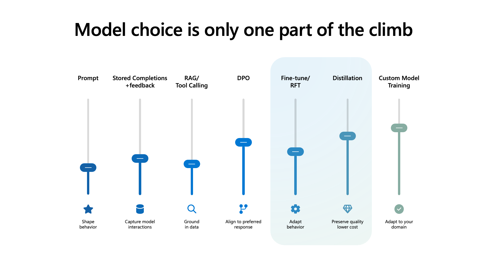

<!-- 
Image description: 
Slide titled "Model choice is only one part of the climb." Seven vertical sliders, each with an icon and caption: Prompt (shape behavior); Stored Completions + feedback (capture model interactions); RAG / Tool Calling (ground in data); DPO (align to preferred response); Fine-tune / RFT (adapt behavior) and Distillation (preserve quality, lower cost), highlighted together; and Custom Model Training (adapt to your domain).

Timing: 30 seconds
Cumulative: 22:50

-->

<!--
Speaker notes:
Before we do, one quick note. Model Router isn't the only way to bring cost down while keeping quality comparable. Another option is distillation.

Here's how it works. We take our best version of the agent as the teacher, collect its good answers from the traces, and use them to fine-tune a smaller, cheaper student model to do the same job. With a good teacher and good examples, the student can keep most of the quality for a lot less cost.

We'll come back to this later, once we have a teacher worth learning from.

Presenter Guidance:
Point to the highlighted Fine-tune and Distillation columns; don't explain the other sliders. In the session repo, the fine-tuning lab (infra/09-fine-tune.sh) runs after Agent Optimizer. We don't cover it in detail in this session.
-->

---

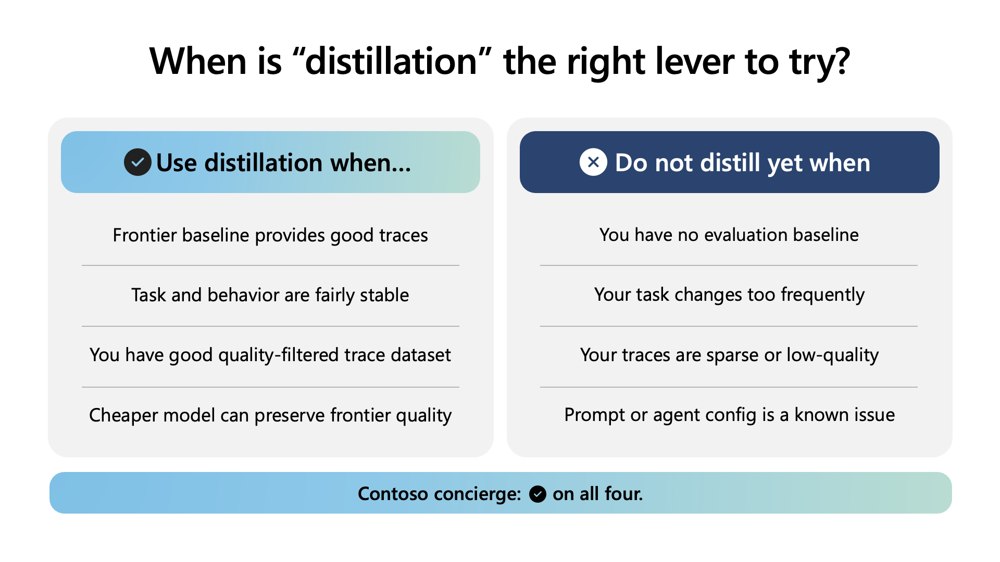

<!-- 
Image description: 
Slide titled "When is 'distillation' the right lever to try?" Two columns. "Use distillation when…": frontier baseline provides good traces; task and behavior are fairly stable; you have a good quality-filtered trace dataset; cheaper model can preserve frontier quality. "Do not distill yet when": you have no evaluation baseline; your task changes too frequently; your traces are sparse or low-quality; prompt or agent config is a known issue. Banner: "Contoso concierge: ✓ on all four."

Timing: 30 seconds
Cumulative: 23:20

-->

<!--
Speaker notes:
So when does distillation make sense? When you have a strong teacher with good traces, a task that's fairly stable, a clean set of examples, and a cheaper model that can keep up.

And when should you wait? When you don't have a baseline yet, the task keeps changing, the traces are weak, or you already know the prompt is the problem.

Our concierge ticks all four on the left. But look at that last one on the right. We just learned our instructions are the problem. Distill now, and the student copies the teacher's policy mistakes.

So first, let's fix the instructions.

Presenter Guidance:
Don't read both columns word for word. Land the last row on the right: "Prompt or agent config is a known issue." That's why distillation waits until after Agent Optimizer.
-->

---

<!-- 
Image description: 
Act 3 divider with a "Make it scale" label above the title "Automate the Optimization Loop," a blue circular-arrows icon, and "The Agent Optimizer" in large gradient text.

Timing: 25 seconds
Cumulative: 23:45

-->

<!--
Speaker notes:
We could fix the instructions by hand. Rewrite the prompt, redeploy, rescore, and repeat until something works.

But remember Lydia? Models change, requirements change, and Caldova will have more than one agent. Running every experiment by hand won't scale.

So Act 3: make it scale. Let's automate the climb with Agent Optimizer.

Presenter Guidance:
Pause on the slide for a beat before speaking. Lydia is back in the story here; she's been offstage since the opening.
-->

---

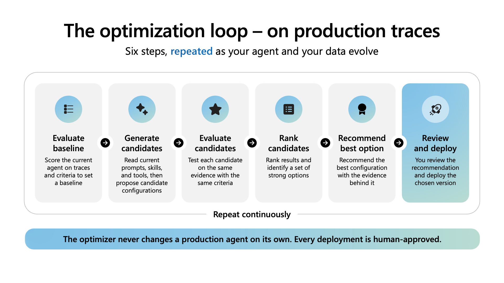

<!-- 
Image description: 
Slide titled "The optimization loop – on production traces," subtitle "Six steps, repeated as your agent and your data evolve." Six cards connected by arrows: Evaluate baseline (score the current agent on traces and criteria to set a baseline); Generate candidates (read current prompts, skills, and tools, then propose candidate configurations); Evaluate candidates (test each candidate on the same evidence with the same criteria); Rank candidates (rank results and identify a set of strong options); Recommend best option (recommend the best configuration with the evidence behind it); and Review and deploy, highlighted (you review the recommendation and deploy the chosen version). "Repeat continuously" runs beneath the cards. Banner: "The optimizer never changes a production agent on its own. Every deployment is human-approved."

Timing: 35 seconds
Cumulative: 24:20

-->

<!--
Speaker notes:
Agent Optimizer runs the same climb we just did by hand, automatically.

It starts by scoring the current agent, using the same traces and the same rubric. Then it reads the agent's prompts, skills, and tools, and proposes candidate changes. Each candidate takes the same test, against the same bar. It ranks the results and recommends the best one, with the evidence behind it.

And when things change, you just run it again.

But notice the last step. It never changes your production agent on its own. A person reviews the recommendation and decides what ships. Just like we said at the start: automation does the heavy lifting, people decide.

Presenter Guidance:
Walk the cards left to right, then land on the highlighted last card and the banner. The last line calls back to slide 10. Agent Optimizer is generally available.
-->

---

<!-- 
Image description: 
"Generally Available" badge above the title "Agent Optimizer," subtitle "Agents optimized to your goals, grounded in your production evidence." A text panel explains that Agent Optimizer improves deployed agents using what you already have: the agent configuration, production traces, and your success criteria. It reads the current prompts, skills, tools, and model, searches for better configurations, tests each candidate against the same evidence, and recommends the best version for you to review and deploy. Three cards: Better outcomes (improve quality and reliability against the evaluators you already trust); Lower cost (find more efficient configurations without giving up quality); and Faster iteration (automate the experiments that used to take a team weeks). Footer: "Data + evaluators + optimization = repeatable improvement."

Timing: 15 seconds
Cumulative: 24:35

-->

<!--
Speaker notes:
So what does that buy us? Better outcomes, measured against the evaluators we already trust. Lower cost, without giving up quality. And faster iteration: experiments that used to take a team weeks, now automated.

That's what Lydia needs.

Presenter Guidance:
Deliver the three cards as one line and let the slide carry the detail. Agent Optimizer is generally available.
-->

---

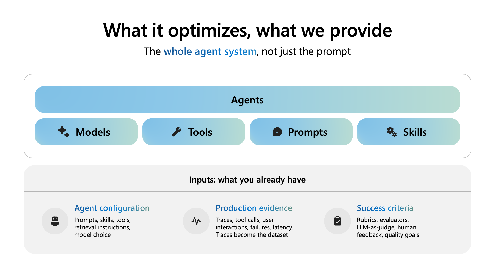

<!-- 
Image description: 
Slide titled "What it optimizes, what we provide," subtitle "The whole agent system, not just the prompt." A panel shows an "Agents" bar above four blocks: Models, Tools, Prompts, and Skills. Below, "Inputs: what you already have" lists three: Agent configuration (prompts, skills, tools, retrieval instructions, model choice); Production evidence (traces, tool calls, user interactions, failures, latency; traces become the dataset); and Success criteria (rubrics, evaluators, LLM-as-judge, human feedback, quality goals).

Timing: 30 seconds
Cumulative: 25:05

-->

<!--
Speaker notes:
And here's the nice part: we already have everything it needs.

The agent configuration, from Act 1. The traces, which Insights already turned into evidence. And our success criteria: the rubric we locked before scoring version one.

Agent Optimizer can tune the whole agent system: models, tools, prompts, and skills. In our demo, we'll keep it focused on the instructions, because that's what's holding back policy-gate compliance.

Presenter Guidance:
Point to the three inputs and connect each one to something the audience has already seen. The demo optimizes instructions only; Agent Optimizer can also try other model deployments, tools, and skills.
-->

---

<!-- 
Image description: 
Demo divider reading "Demo: Automate with Agent Optimizer," with the subtitle "Production Insights, Evaluate Candidates, Promote Winner," over a blue and violet ribbon graphic. Lydia's photo sits in the lower left beside a "Let's iterate faster!" label.

Timing: 20 seconds
Cumulative: 25:25

-->

<!--
Speaker notes:
For Lydia, this is the moment: let's iterate faster.

Once again, Copilot gives us the command to run. And just like with the rubric, there's more than one way in. There's a Foundry skill for Agent Optimizer that Copilot can use, or Copilot can drive it for us through the SDK or azd. Either way, the heavy lifting happens in Foundry. Agent Optimizer generates the candidates, scores them, and comes back with a recommendation.

Let's see what it finds.

Presenter Guidance:
Keep it quick. Have CLIP10-OPTIMIZER ready on the next slide. The skill is the "agent-optimizer" workflow in the Microsoft Foundry skill.
-->

---

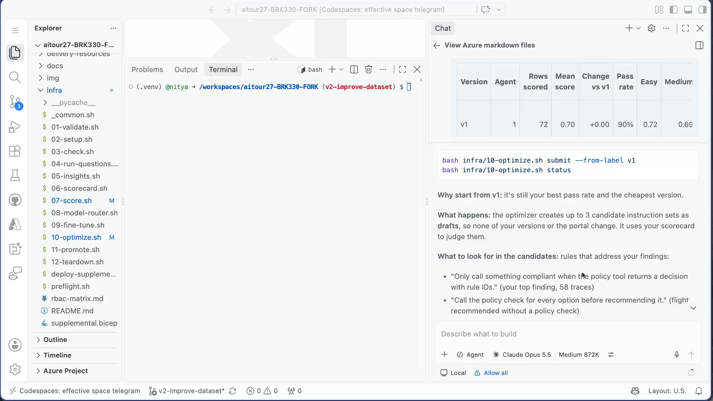

<!-- 
Image description: 
VS Code with Copilot Chat. A results table shows the v1 baseline row (72 rows scored, mean 0.70, pass rate 90%, easy 0.72, medium 0.69). Copilot gives the commands bash infra/10-optimize.sh submit --from-label v1 and bash infra/10-optimize.sh status. It explains why to start from v1 (still the best pass rate and the cheapest version), that the optimizer creates up to three candidate instruction sets as drafts so no versions or the portal change, and that it uses the scorecard to judge them. "What to look for in the candidates" lists rules that address the Insights findings: "Only call something compliant when the policy tool returns a decision with rule IDs" (the top finding, 58 traces) and "Call the policy check for every option before recommending it" (flight recommended without a policy check).

Timing: 130 seconds
Cumulative: 27:35

-->

<!--
Speaker notes:
We start from version one. It still has our best pass rate, so it's the right place to climb from.

Copilot gives us the command, and Agent Optimizer gets to work. It creates up to three candidate sets of instructions, as drafts. Nothing in production changes, and Krystal's portal stays on version one. Every candidate is judged with the same rubric.

And look at what it proposes. Rules that go straight at our Insights findings. "Only call something compliant when the policy tool returns a decision with rule IDs." That's our top finding, the fifty-eight traces. "Call the policy check for every option before recommending it." That's the flight recommended without a check.

Then the candidates take the test. The first one actually goes backward, and that's useful. Not every step in a hill climb goes up. The second inches ahead. And the third is a clear step up from our baseline. We have a winner.

It does use more tokens, because the instructions are longer and more careful. But it's actually faster.

So now we have version three: better instructions, clearly better quality. And that brings us back to our plan. What happens if we combine these better instructions with Model Router? Can we bring the cost down too?

Presenter Guidance:
Play CLIP10-OPTIMIZER (1:57). Read the two candidate rules aloud; they tie directly back to the Insights findings from Act 1. Pause on the score comparison chart and let the audience see candidate 1 go backward before the winner. Talk about the trend, not the exact scores. If asked: baseline 0.712, candidate 1 0.676, candidate 2 0.72, candidate 3 0.774 (+0.062); average tokens 6.2K to 10K; average latency 14.2 s to 10.2 s. The optimizer's baseline score (0.712) differs slightly from our three-round v1 score (0.70) because it's a separate evaluation run. The clip is edited; cloud run time varies.
-->

---

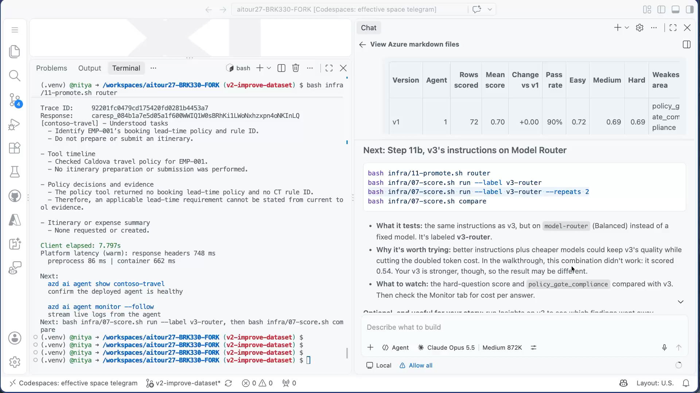

<!-- 
Image description: 
VS Code with the terminal on the left and Copilot Chat on the right. The terminal shows bash infra/11-promote.sh router running a smoke test: the agent identifies the employee's booking lead-time policy, checks Caldova travel policy, and states that no applicable lead-time rule was returned rather than inventing one. Copilot Chat shows the v1 baseline row and "Next: Step 11b, v3's instructions on Model Router," with commands to promote v3's instructions onto model-router (Balanced) as v3-router, score it, and compare. Notes say what it tests, why it's worth trying (better instructions plus cheaper models could keep v3's quality while cutting the doubled token cost), and what to watch: the hard-question score, policy_gate_compliance, and cost per answer in the Monitor tab.

Timing: 215 seconds
Cumulative: 31:10

-->

<!--
Speaker notes:
So, back to Model Router, just like we planned. Same idea as before: one change. We keep version three's new instructions, and swap the model for Model Router.

Look at this quick test run. When the policy tool doesn't return a lead-time rule, the agent says so, instead of making one up. That's exactly the behavior Insights flagged in Act 1, now fixed.

Then we score it the same way: same questions, same rubric, two rounds.

And this time, it works. This is our best version yet. Quality is up, and the pass rate is the highest we've seen. Policy-gate compliance, the problem Insights found at the very start, is better than version one.

Remember, on its own the router made things cheaper, but not better. With better instructions, it's a different story. Better instructions and the right models, working together.

It's not a free win. It uses more tokens than version one, and the slowest answers take a bit longer. But the typical answer is actually faster. And with the router choosing the models, we'll see what that means for Andre's bill in a moment.

We didn't guess our way here. We followed the evidence, made one change at a time, and kept what moved us uphill.

Presenter Guidance:
Play CLIP11-OPTIMIZER-ROUTER (3:24). This is the longest clip: let it run, and speak at the key moments rather than over all of it. Point to the test-run output first: no invented lead-time rule. Then pause on the v1 / v3 / v3-router table. Talk about the trend, not the exact numbers; the final cost figures are on slide 47. Don't read the walkthrough comparison Copilot quotes (0.54); it comes from an earlier run. Don't quote the Monitor tab's total cost: the model-router deployment also includes v2's earlier runs. If asked: v1 0.70 / 90%, v3 0.72 / 94%, v3-router 0.73 / 96%; policy_gate_compliance 3.52 to 3.65; P50 latency 10.0 s to 9.6 s, P95 17.9 s to 22.3 s; tokens per answer about double v1.
-->

---

<!-- 
Image description: 
Slide titled "Metrics improve at every stage of the loop." A rising bar chart with four bars: Baseline (0.7 | 90%), + Agent Optimizer (0.72 | 94%), + Model Router (0.73 | 96%), and + Fine-Tuning (the tallest bar, with a "NEXT STEP" label instead of figures). A dashed target line marks "Pass Rate > 95%, Quality Score > 0.71"; only the Model Router and Fine-Tuning bars rise above it.

Timing: 40 seconds
Cumulative: 31:50

-->

<!--
Speaker notes:
So let's step back and look at the whole climb.

We started at our baseline, below Caldova's targets. Agent Optimizer fixed the instructions, and quality cleared the bar. Adding Model Router on top took the pass rate over the line too. Both targets met.

And not every step made it onto this chart. Our two router-only experiments didn't get promoted. But they told us where the real problem was.

And the climb doesn't stop here. Remember distillation? Now we have a teacher worth learning from. That's the next step. The session repo has the lab and our results, so you can try it yourself. And the same goes for the model behind Insights: it's one more part of the system we can tune.

That's hill climbing: one change at a time, measured every time.

Presenter Guidance:
Walk the bars left to right and point to the dashed target line. Present the Fine-Tuning bar as the next step, not a recorded result; the lab (infra/09-fine-tune.sh) and results are in the session repo. If you're short on time, skip the router-only line.
-->

---

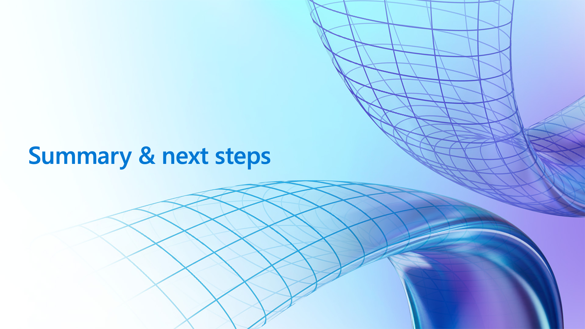

<!-- 
Image description: 
Section divider reading "Summary & next steps" over translucent blue and violet ribbon shapes.

Timing: 15 seconds
Cumulative: 32:05

-->

<!--
Speaker notes:
We've reached the top of this hill, for this version of the agent.

So let's bring Krystal, Andre, and Lydia back, see what changed for each of them, and turn this into a playbook you can use.

Presenter Guidance:
Pause on the slide for a beat before speaking.
-->

---

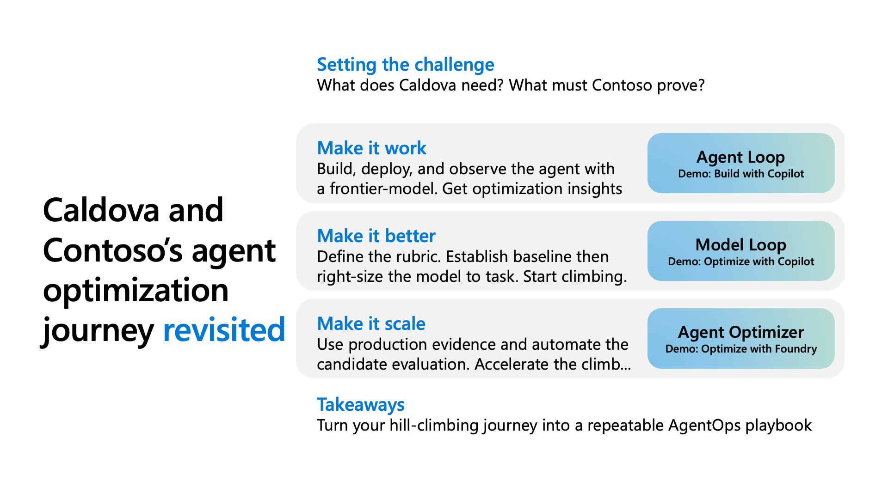

<!-- 
Image description: 
Roadmap slide titled "Caldova and Contoso's agent optimization journey revisited." Setting the challenge (what does Caldova need, what must Contoso prove?); Make it work (build, deploy, and observe the agent with a frontier model, get optimization insights), paired with Agent Loop, Demo: Build with Copilot; Make it better (define the rubric, establish the baseline, then right-size the model to the task and start climbing), paired with Model Loop, Demo: Optimize with Copilot; Make it scale (use production evidence and automate candidate evaluation to accelerate the climb), paired with Agent Optimizer, Demo: Optimize with Foundry; and Takeaways (turn your hill-climbing journey into a repeatable AgentOps playbook).

Timing: 50 seconds
Cumulative: 32:55

-->

<!--
Speaker notes:
So let's look back at the journey.

We made it work. Copilot helped us build and deploy the concierge on one frontier model. Traces showed us what it was really doing, and Insights pointed us to the policy problem behind Krystal's failed booking.

We made it better. We defined what "good" means with a rubric, set our baseline, and started climbing. Model Router alone made it cheaper, but not better. And that told us where the real problem was.

And we made it scale. Agent Optimizer fixed the instructions automatically, using the same evidence and the same rubric. Add Model Router back on top, and we cleared Caldova's targets.

So Krystal gets a concierge that's much better at following policy. Lydia gets a process that keeps improving as things change. But what about Andre?

Presenter Guidance:
Walk the three rows top to bottom, one persona per row. End on the question to set up Andre's slide.
-->

---

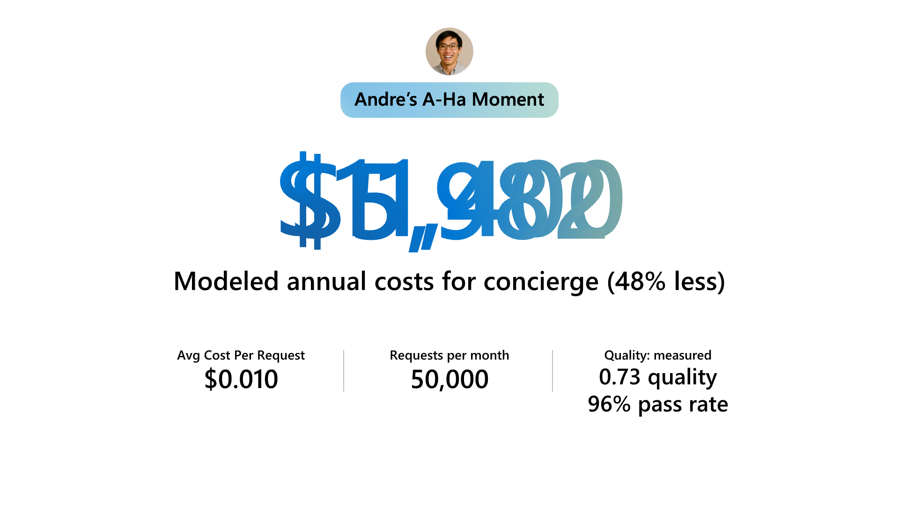

<!-- 
Image description: 
Andre's photo above an "Andre's A-Ha Moment" label. A large animated figure changes from $11,400 to $5,982, captioned "Modeled annual costs for concierge (48% less)." Three figures below: Avg Cost Per Request $0.010, Requests per month 50,000, and Quality: measured (0.73 quality, 96% pass rate).

Timing: 40 seconds
Cumulative: 33:35

-->

<!--
Speaker notes:
Remember Andre's math? Eleven thousand four hundred dollars a year, and a big question mark next to quality.

Here's where we landed. About a penny per request. Same fifty thousand requests a month. That's just under six thousand dollars a year. Almost half.

But the bigger change is that question mark. Andre can now see what he's paying for: a quality score of 0.73, and ninety-six percent of answers passing Caldova's bar. Up from where we started, on the same rubric.

So it's not just a cheaper agent. It's a better one, with evidence that connects cost, quality, and risk. That's a decision Andre can defend.

Presenter Guidance:
Let the number animate before you speak. These figures were calculated with Copilot from the final traces and model mix, using the same 50,000 requests a month as slide 17.
-->

---

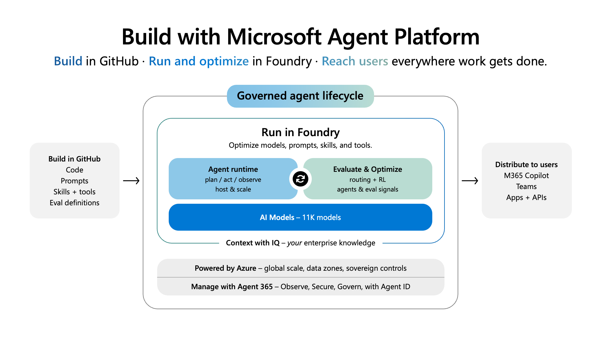

<!-- 
Image description: 
Slide titled "Build with Microsoft Agent Platform," subtitle "Build in GitHub · Run and optimize in Foundry · Reach users everywhere work gets done." Left: "Build in GitHub" (code, prompts, skills + tools, eval definitions), with an arrow into a central "Governed agent lifecycle" box. Inside it, "Run in Foundry: optimize models, prompts, skills, and tools," with Agent runtime (plan / act / observe, host & scale) and Evaluate & Optimize (routing + RL, agents & eval signals) linked by a cycle icon, above an "AI Models – 11K models" bar and "Context with IQ – your enterprise knowledge." Beneath: "Powered by Azure – global scale, data zones, sovereign controls" and "Manage with Agent 365 – Observe, Secure, Govern, with Agent ID." Right: "Distribute to users" (M365 Copilot, Teams, Apps + APIs).

Timing: 50 seconds
Cumulative: 34:25

-->

<!--
Speaker notes:
And Contoso? They delivered something all three of Caldova's stakeholders can stand behind.

Here's how it fits together. We built in GitHub, with Copilot. And we never had to know azd, the SDK, or the evaluation APIs up front. Copilot knew them, through Foundry skills or by writing the code, and when something broke, we fixed it together in the conversation.

We ran and optimized in Foundry. Traces, Insights, the rubric evaluator, Model Router, and Agent Optimizer, all working on the same evidence.

And when the agent is ready, it can reach people where they already work, like Microsoft 365 Copilot and Teams, with Agent 365 for governance across the whole lifecycle.

Build in GitHub. Run and optimize in Foundry. Reach users everywhere.

Presenter Guidance:
Follow the diagram left to right. Spend most of the time on the middle box. Distribution and governance are covered in other AI Tour sessions; one sentence is enough.
-->

---

<!-- 
Image description: 
Slide titled "Optimize the system, not just the prompt," subtitle "Build Your Agent Optimization Playbook." Five numbered rows: 1. Pick the model for the workload (define business targets across quality, cost, and latency); 2. Evaluate on your data (evaluate on representative data and production evidence); 3. Optimize the system (choose the right lever: models, prompts, skills, tools, or context); 4. Operate with control (compare optimized candidates and promote with control); 5. Continuously improve (monitor, revalidate, and repeat as the landscape changes). Banner: "Join the Community: https://aka.ms/foundry/discord."

Timing: 45 seconds
Cumulative: 35:10

-->

<!--
Speaker notes:
If you remember one thing from today, make it this: optimize the system, not just the prompt.

Here's the playbook, and you've just seen every step.

Pick a sensible model, and set targets for quality, cost, and latency. That's where Caldova started.

Evaluate on your own data, not someone else's benchmark. That's our rubric and our baseline.

Choose the lever that fits the problem. For us, the model alone wasn't it. The instructions were.

Compare every candidate against the same bar, and keep a person in charge of what ships.

And keep going. Models, users, and requirements will change, so run the loop again.

Presenter Guidance:
Tie each row to a moment from the demo; don't read the right-hand column. Point to the Discord link at the bottom.
-->

---

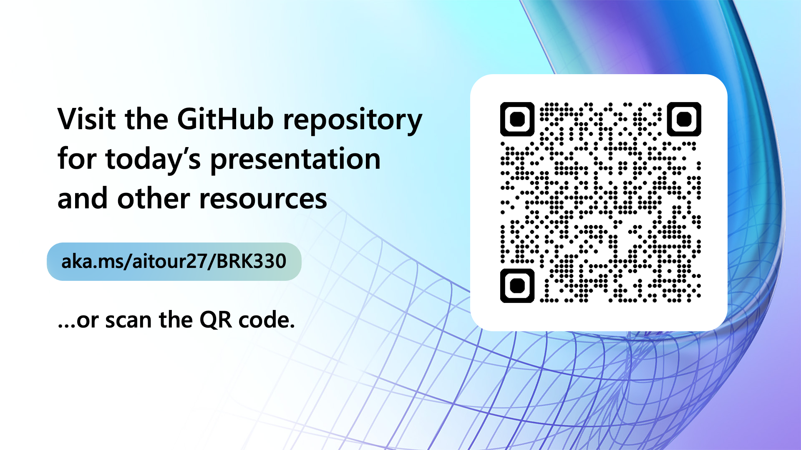

<!-- 
Image description: 
Closing slide reading "Visit the GitHub repository for today's presentation and other resources," with the short link aka.ms/aitour27/BRK330 in a blue pill, "...or scan the QR code," and a large QR code on the right, over a blue and violet ribbon graphic.

Timing: 25 seconds
Cumulative: 35:35

-->

<!--
Speaker notes:
Everything you saw today is in the session repo: the agent, the scripts, the clips, and the fine-tuning lab we didn't have time for. And it comes with a Copilot helper that walks you through it step by step, just like you saw.

Scan the QR code, or go to aka.ms/aitour27/BRK330.

Start with your own agent. Define what good looks like, set your baseline, and take one measured step uphill.

Thank you.

Presenter Guidance:
Leave the slide up while people scan. Point to both the QR code and the short link.
-->
